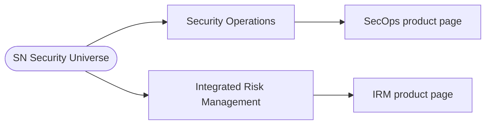
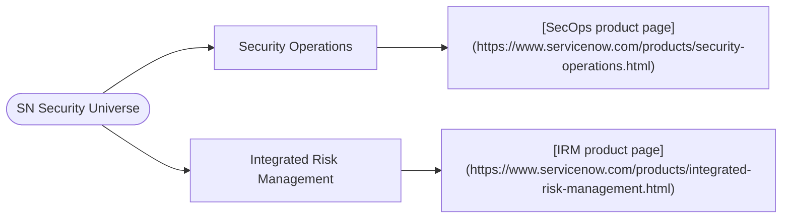
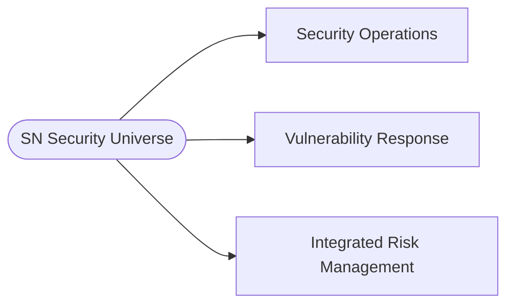
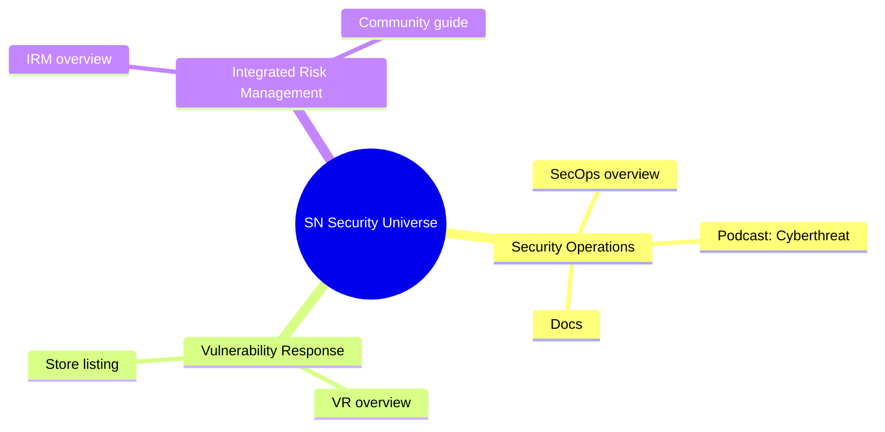
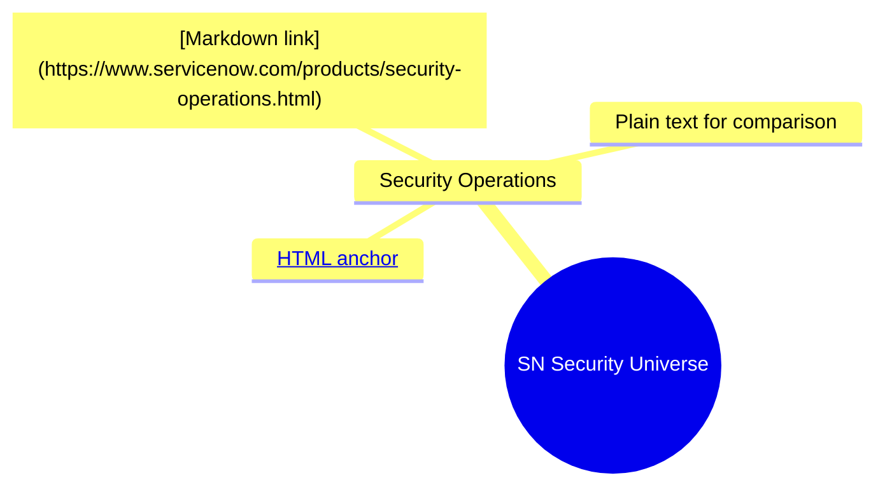

# SN Security Universe: render test

## A. Nested details

<b>Security Operations</b>

- Overview: [SecOps product page](https://www.servicenow.com/products/security-operations.html)
- Podcast: [Cyberthreat: Real Answers to Real Problems](https://podcasts.apple.com/podcast/id1439624860)
- Blog: [ServiceNow Blogs](https://www.servicenow.com/blogs.html)
- Docs: [Product Documentation](https://docs.servicenow.com)
- Video: [ServiceNow on YouTube](https://www.youtube.com/@servicenow)

<b>Vulnerability Response</b>

- Overview: [VR product page](https://www.servicenow.com/products/vulnerability-response.html)
- Store: [VR on the Store](https://store.servicenow.com/store/app/21d8a32e1be06a50a85b16db234bcb7e)

<b>Integrated Risk Management</b>

- Overview: [IRM product page](https://www.servicenow.com/products/integrated-risk-management.html)
- Community: [Risk adoption guide](https://www.servicenow.com/community/grc-articles/welcome-to-servicenow-risk-get-started-on-your-product-adoption/ta-p/3038531)

## B. Mermaid with click directives

## C. Mermaid with Markdown links in labels

# SN Security Universe: hybrid test

## D. Overview (static, clickable)

## E. Mindmap (static)

## F. Expandable links (click the arrows)

<b>Security Operations</b>

- Overview: [SecOps product page](https://www.servicenow.com/products/security-operations.html)
- Podcast: [Cyberthreat: Real Answers to Real Problems](https://podcasts.apple.com/podcast/id1439624860)
- Docs: [Product Documentation](https://docs.servicenow.com)

<b>Vulnerability Response</b>

- Overview: [VR product page](https://www.servicenow.com/products/vulnerability-response.html)
- Store: [VR on the Store](https://store.servicenow.com/store/app/21d8a32e1be06a50a85b16db234bcb7e)

<b>Integrated Risk Management</b>

- Overview: [IRM product page](https://www.servicenow.com/products/integrated-risk-management.html)
- Community: [Risk adoption guide](https://www.servicenow.com/community/grc-articles/welcome-to-servicenow-risk-get-started-on-your-product-adoption/ta-p/3038531)

## G. Mindmap link tests

